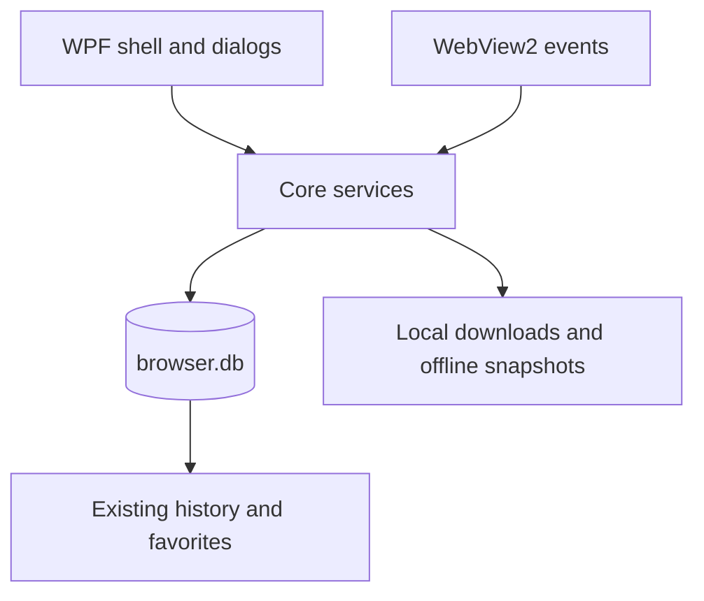

# Madagascar Browser Completion Design

## Goal

Make Madagascar Browser practical for daily Windows use while preserving its local-first design and existing WPF, WebView2, SQLite, and .NET 8 stack.

## Scope

The completion work covers:

- Persistent browser preferences: search provider, ad blocking, and data saver.
- Usable bookmark and history management, including removal and clearing.
- Download initiation, progress/state visibility, cancellation, and opening completed files.
- Restoration of the previous set of tabs after restart.
- Explicitly saved offline pages, stored locally and available from the browser UI.
- Local profile export/import for bookmarks, history, and preferences.

It excludes cloud synchronization, password storage, browser extensions, and Chromium feature parity. No new package is required. Existing user data must remain readable.

## Architecture

The WPF shell remains responsible for UI, native file dialogs, WebView2 events, and process-level lifecycle. `MadagascarBrowser.Core` owns testable persistence and business rules. SQLite remains the primary store under `%LocalAppData%\\MadagascarBrowser`; offline snapshots are files under the same application data directory, with metadata in SQLite.

Database initialization adds tables using idempotent migrations and does not drop or rewrite existing history/favorites. Downloads and session state are local. Imported profile data is validated and applied transactionally where supported.

## Decisions

### Keep the current stack

Use WebView2's existing download and page-capture capabilities, WPF controls/dialogs, and `Microsoft.Data.Sqlite`. This avoids runtime and packaging complexity. The trade-off is that UI integration must remain on the WPF dispatcher and WebView2 APIs.

### Save offline pages explicitly

Offline availability is opt-in per page, not an invisible cache of arbitrary browsing. Save WebView2's MHTML snapshot to an app-managed local file, list saved pages, and open them locally. This is deterministic, bounded, and can be tested without pretending that arbitrary web resources are reliably cacheable.

### Restore tabs locally

Persist ordered HTTP(S) tab URLs and the active tab when the window closes; restore them at next startup only when the preference is enabled. Never persist transient error/start pages as session URLs.

### Privacy defaults

Keep data saver off by default, consistent with its current behavior. Keep existing ad-block behavior on by default, but make it configurable. Provide a clear-history action; profile export is an explicit user action and never happens automatically.

## Functional behavior

- Search provider can be changed in settings; new address-bar searches use the selected provider while explicit URLs remain unchanged.
- Data-saver and ad-block toggles persist between launches and affect subsequent resource requests.
- Bookmarks can be added from the current page, opened, and removed. History can be searched, opened, removed by URL, and cleared with confirmation.
- Downloads use a native Save As dialog, show active/completed/cancelled/failed state and progress, support cancellation, and open only completed files through the OS shell.
- Session restoration preserves tab order and active tab and tolerates malformed or unreachable saved URLs.
- Offline snapshots are saved and opened from a local list; failed writes leave no partial entry/file.
- Profile backup exports/imports bookmarks, history, and preferences in JSON. Invalid imports fail without partially replacing existing data. Download files, offline page contents, and session tabs are not included.

## Failure handling and security

- Database updates are additive and idempotent; existing tables are untouched.
- Failed/cancelled downloads remain accurately labelled and are not opened automatically.
- File names are normalized by WebView2/save-dialog behavior; saved downloads and snapshots stay within user-selected or application-owned paths.
- Profile import validates the full document and supported version before applying it; SQL values remain parameterized.
- WebView2 initialization failure retains the existing fallback screen.

## Verification

- xUnit tests cover settings persistence/defaults, history removal/clear, download state persistence, session ordering, offline metadata/file lifecycle, and profile validation/round-trip.
- Build and run the complete solution test suite after each Core/UI vertical slice.
- On Windows, smoke-test settings persistence, adding/removing a bookmark, clearing history, download cancellation/completion, session restore, offline save/open, and profile export/import through the desktop UI.
